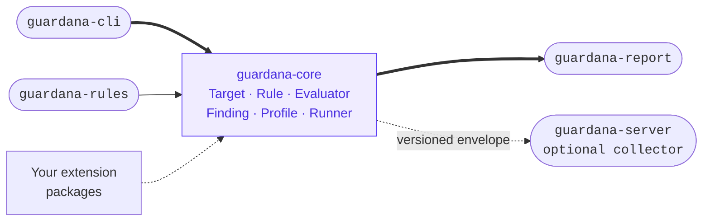

# Architecture

## Packages

```
guardana-core     Target / Rule / Evaluator / Finding / Profile,
                   the Registry (discovery) and Runner (execution),
                   plus threat-agnostic plumbing rules build on:
                   `formats` (bounded model-file readers) and `testing`
                   (doubles and artifact builders).
                   No network I/O beyond what a Target, a judge configured
                   under `evaluators:` or the collector reporter performs.
guardana-rules     Built-in rules (YAML + Python plugin), each mapped to
                   OWASP / MITRE ATLAS / NIST.
guardana-cli       The `guardana` command — scan, probe, monitor, diff
                   and the rest; `guardana --help` lists them all.
guardana-report    Renderers: human, SARIF, JSON, JUnit.
guardana-server    OPTIONAL collector. Ingests normalized Findings from many
                   agents; list/trend view. A separate, separately-deployed
                   service.
```



Each is `src/guardana/<name>` — a PEP 420 namespace package. No package
directory has a bare `guardana/__init__.py`; only the subpackages
(`guardana.core`, `guardana.rules`, etc.) do, so five distributions can
contribute to the same `guardana.*` namespace without conflict.

## The five abstractions

### 1. Target — what we inspect

`guardana.core.target.Target` is a uniform interface over the thing under
test, so a rule never hard-codes whether it's reading files or talking to a
model:

```python
class TargetKind(StrEnum):
    ARTIFACT = "artifact"
    ENDPOINT = "endpoint"
    TRACE = "trace"

class Capability(StrEnum):
    READ_FILES = "read_files"
    CHAT = "chat"
    PLANT_SYSTEM_PROMPT = "plant_system_prompt"
    CALL_TOOLS = "call_tools"

class Target(ABC):
    kind: TargetKind
    def capabilities(self) -> set[Capability]: ...
    @property
    def ref(self) -> str: ...   # stable id used in findings/reports
```

Every `RuleMeta` also carries a derived **`surface`** (`Surface.BUILD` for
artifact rules, `Surface.RUNTIME` for endpoint rules) — the conceptual split
between securing how a model is *built* and how it *behaves*. It needs no
per-rule declaration; `guardana rules` groups by it and takes `--surface`.

Built-ins: `ArtifactTarget` (walks a directory, exposing `iter_files(suffixes)`
over model files, dependency manifests, and source, skipping `.git`,
`.venv`, `node_modules`, etc., plus `python_source(path)` — a Python file read,
parsed and indexed **once per scan** rather than once per rule, so scan cost
grows with the target instead of with the rule count) and `EndpointTarget` (a live chat endpoint,
exposing `chat(messages) -> str`, with a pluggable `ChatTransport` so tests
never hit the network). The transport is selected by a provider name —
`openai` (the default, any OpenAI-compatible server), `ollama` (native
`/api/chat`), or `tgi` (HF TGI `/generate`) — or by an adapter file mapping a
guarded endpoint's own request and response. Both are read through one `Connection`
(`guardana.core.target.connection`): `--provider` and `--adapter` on `probe`,
`plan probe`, `target inspect` and `monitor`, and `provider` and `adapter` in a judge's
`evaluators:` block, refused alike before anything is sent when they cannot be used as
written. A genuinely custom backend ships a `Target` through the
`guardana.targets` entry point instead. An OpenAI-compatible transport also
implements the optional `ToolCallingTransport` protocol, so `EndpointTarget`
advertises `CALL_TOOLS` and exposes `offer_tools(messages, tools)` — the seam
the excessive-agency rule uses to observe which tools a model calls (`ollama`
and `tgi` simply don't advertise the capability).

`ArtifactTarget` finds the files; **`guardana.core.formats` reads them**.
`read_gguf_metadata`, `read_safetensors_header` and `read_onnx_summary` are
public, bounded, offline, deterministic and fail-closed, and they return *data,
never a verdict* — which is the line that keeps threat knowledge in rules and
binary parsing in the engine. It is the same move as `guardana.core.testing`:
core ships plumbing so a third-party pack ships judgement. Full contract in
[`model-formats.md`](model-formats.md).

**Skipped is not errored.** The `Runner` keeps two outcomes apart that used to
share a bucket: a rule the target cannot satisfy is *skipped* (normal), and a
rule that raised is an *error* (a defect) recorded in `ScanResult.errors`, which
fails the gate by default. `Registry.discover(trust)` isolates each entry point for
the same reason — one broken third-party pack must not leave you with no rules.

A rule declares which capabilities it needs (`required_capabilities` in
`RuleMeta`); the `Runner` skips a rule outright — no crash — when the
target it's given can't satisfy them, e.g. an endpoint-only prompt-injection
rule is skipped against an `ArtifactTarget`.

### 2. Rule — what to look for

```python
@dataclass(frozen=True, slots=True)
class RuleMeta:
    id: str
    title: str
    severity: Severity
    target_kind: TargetKind
    taxonomy: tuple[TaxonomyRef, ...] = ()
    required_capabilities: frozenset[Capability] = frozenset()
    evaluator: str | None = None

class Rule(ABC):
    meta: RuleMeta
    def run(self, target: Target, ctx: RuleContext) -> Iterable[Finding]: ...
```

Two authoring paths, one contract: **declarative YAML** for "send this
corpus, grade with this evaluator", or a **Python plugin** (any `Rule`
subclass) for logic YAML can't express. Declarative rules come in two
shapes, both loaded by `load_yaml_rules`: single-turn `YamlRule` (a
`prompts:` list, each graded independently) and multi-turn `ScenarioRule` (a
`steps:` conversation graded per step and/or as a whole). See
[`writing-rules.md`](writing-rules.md) for the full authoring guide.

### 3. Evaluator — did it succeed, and how sure are we

The differentiator. `guardana.core.evaluator.Evaluator` turns a model
response into a verdict with a confidence and a rationale, instead of a
bare true/false:

```python
class Evaluator(ABC):
    id: str
    def evaluate(self, exchange: Exchange, expectation: Expectation) -> Verdict: ...

@dataclass(frozen=True, slots=True)
class Verdict:
    outcome: Literal["pass", "fail", "inconclusive"]
    confidence: float
    rationale: str
    evaluator_id: str
```

An `Exchange` (`guardana.core.exchange`) is the graded conversation — the
message sequence plus `reply_text` (the last assistant reply, `None` when
there is nothing to grade) and `transcript` (the whole conversation, so a
multi-turn scenario's "across the conversation" goal is gradable). Every
built-in evaluator fails closed on `reply_text is None`: the verdict is
`inconclusive`, never a silent pass.

Shipped evaluators: `keyword` (cheap refusal-marker matching — honestly
low-confidence, ~0.5–0.6), `canary` (near-perfect detection of a planted marker
verbatim, ~0.9–0.99), `length` (grades a reply by length — a runaway answer to a
divergence prompt is a lead, for the unbounded-consumption check), `amplification`
(grades the ratio of what came back to what was asked), `tool_call` (grades an
agent run by what it did, not what it said), `llm_judge` (a versioned judging
prompt sent to a judge model wired from the profile's `evaluators:` block;
confidence is measured as agreement across `min_agreement` samples, and the prompt
version is stamped into `evaluator_id` — `llm_judge@2026.1` — so grading stays
reproducible as the rubric evolves), and `guard` (an opt-in external
safety-classifier — see
[`profiles.md`](profiles.md#config-wired-evaluators-llm_judge-and-guard)).
`guardana calibrate` measures and corrects for errors in `keyword`, `guard`, and
`llm_judge`; the other evaluators are deterministic and need no such correction. A
rule references an evaluator by its string `id`, resolved from the registry at run
time; swapping which evaluator grades a rule requires no change to the rule
itself.

### 4. Report / Finding — normalized result

```python
@dataclass(frozen=True, slots=True)
class Finding:
    rule_id: str
    severity: Severity
    title: str
    taxonomy: tuple[TaxonomyRef, ...]
    target_ref: str
    evidence: Evidence
    verdict: Verdict | None = None   # present for evaluator-graded (dynamic) checks
```

One shape regardless of which rule produced it. `guardana-report` renders a
`ScanResult` — the findings, a rule-run/skip count, the `unverified`
channel (checks that ran but could not reach a verdict — surfaced in every
format, never dropped into a false all-clear), and `observations` (the
components the run saw, taken from the target rather than from the rules, so a
narrowed profile cannot shrink the inventory) — as `human`, `json`, `sarif`,
or `junit` via the `Renderer` protocol
(`render(result: ScanResult) -> str`). `Severity` is an `IntEnum`
(`INFO < LOW < MEDIUM < HIGH < CRITICAL`) so policies threshold with `>=`.
`TaxonomyRef` (`framework`, `id`, `title`) is how OWASP/MITRE/NIST mapping
becomes a typed, filterable field rather than a comment.

### 5. Profile / Policy — what to run and when to fail

```python
@dataclass(frozen=True, slots=True)
class Policy:
    include: tuple[str, ...] = ("*",)
    exclude: tuple[str, ...] = ()
    fail_on: FailOn = field(default_factory=FailOn)

@dataclass(frozen=True, slots=True)
class Profile:
    name: str
    policy: Policy
    rule_config: Mapping[str, Mapping[str, object]] = field(default_factory=dict)
    evaluator_config: Mapping[str, Mapping[str, object]] = field(default_factory=dict)
    rule_paths: tuple[str, ...] = ()
```

Loaded from a `guardana.yaml` file by `load_profile`, or from a named preset
(`ci`/`pre-training`/`monitor`/`release`) via `--preset`. See
[`profiles.md`](profiles.md) for the full field-by-field schema and the presets.

## The Registry — uniform discovery

`guardana.core.registry.Registry` is the one place that finds rules and
evaluators, built-in or third-party, so nothing else in the engine
hard-codes a list of them:

```python
class Registry:
    @classmethod
    def discover(cls, trust: PluginTrust) -> Self:
        reg = cls()
        handlers = {
            # Taxonomies first: a YAML rule's `taxonomy:` resolves while its
            # own entry point is still loading.
            TAXONOMY_GROUP: (TaxonomyRef, reg._record_taxonomy),
            RULE_GROUP: (Rule, reg.register_rule),
            EVALUATOR_GROUP: (Evaluator, reg.register_evaluator),
            TARGET_GROUP: (Target, reg.register_target),
        }
        for entry_point in installed_entry_points():  # the four groups, in that order
            if not trust.allows(entry_point.distribution):
                ...  # recorded as a refusal; never imported
                continue
            ...  # imported; its provider registers everything or nothing
        return reg
```

`Registry.discover(trust)` walks every installed package's four run
groups — `guardana.taxonomies`, `guardana.rules`, `guardana.evaluators`, and
`guardana.targets` [entry points](https://packaging.python.org/en/latest/specifications/entry-points/)
— and calls each one `trust` allows (a zero-arg callable returning either a
single item or an iterable of them — `_absorb` handles both shapes). A
third-party package registered this way is discovered exactly like
`guardana-rules`' own built-ins — there is no built-in/custom distinction at
the registry level, only namespacing by `id` (`guardana.*` reserved for
built-ins; use your own prefix, e.g. `acme.*`).

That same call runs in every CLI mode, `--plugins disabled` (`--no-plugins`'s
deprecated spelling) included: it still walks every installed entry point,
but `PluginTrust.allows()` refuses each one *before*
its code is imported and records the refusal in `load_errors` — the registry
ends up empty, and no entry point's module is imported. The CLI starts with
`builtins` unless a flag or the profile's `plugins:` says otherwise, and records each
refusal the same way. `Registry()`, the bare
constructor with no entry-point walk at all, is for embedding code that wants
to skip discovery entirely — `guardana.core.testing.assert_secure` accepts one
this way when a caller wants no plugins and no CLI involved. See
[`SECURITY.md`](../SECURITY.md) for the trust model this exists for.

**Declarative YAML rules are not entry points** — they're parsed straight
off disk by `load_yaml_rules(path)` and wired into the
registry by whoever provides them (`guardana-rules`' `provide_rules()`
walks its own `catalog/` directory via `importlib.resources`; a third-party
package does the same over its own bundled YAML directory, or a user points
at their own rules directory via `Registry.load_yaml_rule_dirs(paths)` — see
[`writing-rules.md`](writing-rules.md)). `load_yaml_rule_dirs` never raises:
a malformed rule file is recorded in the returned `RuleDirLoad.errors`
instead of aborting the scan, so one bad custom rule can't take down a run.
This is what backs the CLI's `--rules PATH` option (repeatable; also settable
via `guardana.yaml`'s `rules.paths`) on `scan`, `probe`, and `monitor`.

### Current entry-point groups

| Group | Provides | Wired into `Registry`? |
|---|---|---|
| `guardana.taxonomies` | one `TaxonomyRef`, or an iterable | **Yes** — `Registry.discover(trust)`, loaded **first**, so a rule pack's own `taxonomy:` references resolve while its own entry point is still loading. |
| `guardana.rules` | one `Rule`, or an iterable of `Rule`s | **Yes** — `Registry.discover(trust)` |
| `guardana.evaluators` | one `Evaluator`, or an iterable | **Yes** — `Registry.discover(trust)` |
| `guardana.targets` | one `Target` subclass, or an iterable | **Yes** — `Registry.discover(trust)`. `Registry.targets()` exposes the discovered classes; a class declaring a unique `scheme` and `from_locator` is also selectable as `--target scheme://…` by commands accepting its kind. See [`extending.md`](extending.md#adding-a-target). |
| `guardana.renderers` | one `RendererSpec` | **No** — imported only when `--format` names it; see [`outputs.md`](outputs.md) |
| `guardana.reporters` | one `ReporterSpec` | **No** — imported only when `--reporter <name>://` names it |

## The Runner

```python
@dataclass(frozen=True, slots=True)
class Runner:
    registry: Registry
    profile: Profile

    def run(self, target: Target) -> ScanResult: ...
```

Before it selects anything, the runner refuses with `ProfileError` an include pattern
that matches no registered rule, naming each one
([profiles](profiles.md#an-include-pattern-must-match-a-rule)).
For each registered rule: skip it if `target.kind` doesn't match
`meta.target_kind`, or the profile's `Policy.matches(rule_id)` excludes it;
skip it (recording it under `rules_skipped`) if the target can't satisfy
`meta.required_capabilities`; otherwise run it, catching any `Exception` or
`SystemExit` per rule (not `KeyboardInterrupt`) and recording it on the result's
`errors` channel, so one bad rule can't abort the whole scan and the gate fails on
it by default ([when a rule raises](writing-rules.md#what-happens-when-your-rule-raises)). Findings whose verdict is
`inconclusive` are partitioned onto the result's `unverified` channel rather
than counted as confirmed findings — or dropped. `gate(result, policy)` is
the free function that turns a `ScanResult` into the pass/fail boolean CLI
commands use for their exit code (see [`profiles.md`](profiles.md#the-gate));
`fail_on_inconclusive: true` makes the unverified channel gate too.

## The core↔server boundary

**Hard rule: `guardana-core` never imports `guardana-server`, directly or
transitively.** The only connection is one-directional and data-only:

```python
class Reporter(Protocol):
    def submit(self, result: ScanResult, *, source: str) -> None: ...
```

`guardana.core.reporter.HttpReporter` (used by `scan`, `probe`, `monitor` and `analyze-trace` via
`--reporter server://<url>`) POSTs a **versioned JSON envelope** to whatever
URL you give it — it doesn't know or care whether the receiving end is
`guardana-server` or something else entirely:

```json
{
  "schema_version": 8,
  "source": "<path or url#model>",
  "findings": [ ... serialized Findings ... ],
  "unverified": [ ... checks that ran but could not reach a verdict ... ],
  "summary": {"rules_run": 6, "rules_skipped": [], "max_severity": null, "unverified": 0}
}
```

`schema_version` (`guardana.core.reporter.ENVELOPE_SCHEMA_VERSION`, currently
`8`) is what lets an agent and a collector be upgraded independently: a
collector that doesn't understand a version rejects it outright rather than
silently misreading a renamed field. The `unverified` channel is carried over
the wire for the same reason it is surfaced locally — a check that could not be
graded must never reach the collector as a false all-clear.

The version window:

- every change to the envelope raises its version;
- a collector accepts every version from 2 up to its own, so an agent left on an
  older release keeps reporting and sends only what it could observe;
- an agent newer than its collector is refused with `422`, and the refusal names
  the versions the collector speaks — upgrade collectors before agents;
- dropping a version is a major release.

Version 8 is published as
[`collector-envelope/v8.schema.json`](https://guardana.dev/schemas/collector-envelope/v8.schema.json).
The collector's tests send it every envelope a published release wrote, from
version 2 on, and read each one back through the tenant-scoped store. No envelope
version names a tenant: the project comes from the API key.

`guardana-server` is a small, independently deployed FastAPI app
(`guardana.server.app.create_app`) with a PostgreSQL-backed store
(`guardana.server.postgres_store.PostgresStore`). It exposes `POST /findings`,
`GET /findings`, `GET /trend`, `GET /healthz`, `GET /readyz`, and `GET /catalog`.
The health endpoints distinguish a running process from readiness; the catalog
returns the build's rule catalog. `/`, `/healthz` and `/readyz` also answer `HEAD`.
An unhandled error returns `500` with `X-Content-Type-Options: nosniff` and a JSON body without exception text; its traceback goes to the collector's log. It validates submissions with Pydantic models
(`guardana.server.envelope.Submission`), so a malformed POST or an unsupported
`schema_version` is rejected with `422`. Scoped API keys are hashed at rest and
pinned to one project and optionally one environment. An **opt-in dashboard**
(`create_app(dashboard=True)` or `GUARDANA_DASHBOARD=1`, off by default) exposes
`GET /` and aggregated `GET /stats`. Its `POST /session` and `DELETE /session`
endpoints use a read-scoped API key to authenticate a browser session held in an
`HttpOnly`, `SameSite=Strict` cookie.

This boundary is intentional and load-bearing: all OSS value (every rule, every
evaluator, every report format, every CLI mode) works fully offline with zero
dependency on the collector. The collector is a separable, self-hosted layer
(`guardana-server`) with a dashboard, authentication, and persistence. Retention and
deletion ship with it ([`usage-collector.md`](usage-collector.md)); a managed cloud and
fleet management are not built.

## Repository layout

```
guardana/
├─ packages/
│  ├─ guardana-core/   src/guardana/core/{assessment,calibration,contract,diff,evaluator,
│  │                                      judge_error,manifest,monitor,pack,plan,profile,
│  │                                      registry,report,reporter,rule,runner,target,
│  │                                      taxonomy,testing,trace,trajectory,trials,…}
│  ├─ guardana-rules/  src/guardana/rules/{agent,catalog,contract,mcp,output,prompt,
│  │                                       supply_chain,trace,training}
│  ├─ guardana-cli/    src/guardana/cli/{analyze_trace,baseline,calibrate,config,diff,
│  │                                     doctor,init,monitor,new_pack,new_rule,pack,plan,
│  │                                     probe,rule,rules,run,scan,target,taxonomy,trace,…}
│  ├─ guardana-report/ src/guardana/report/{human,diff_human,diff_json,json_report,junit,
│  │                                        sarif}
│  └─ guardana-server/ (optional collector; separate deploy)
├─ docs/               (this directory)
├─ examples/           (sample profile, custom-rule package, contracts, integrators)
├─ CLAUDE.md  CONTRIBUTING.md  CODE_OF_CONDUCT.md  SECURITY.md
└─ pyproject.toml      (uv workspace, ruff, mypy, pytest)
```
